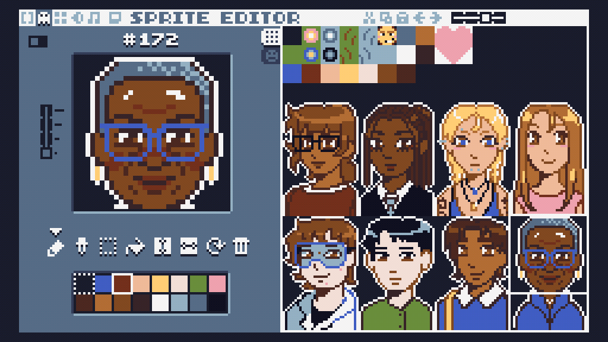
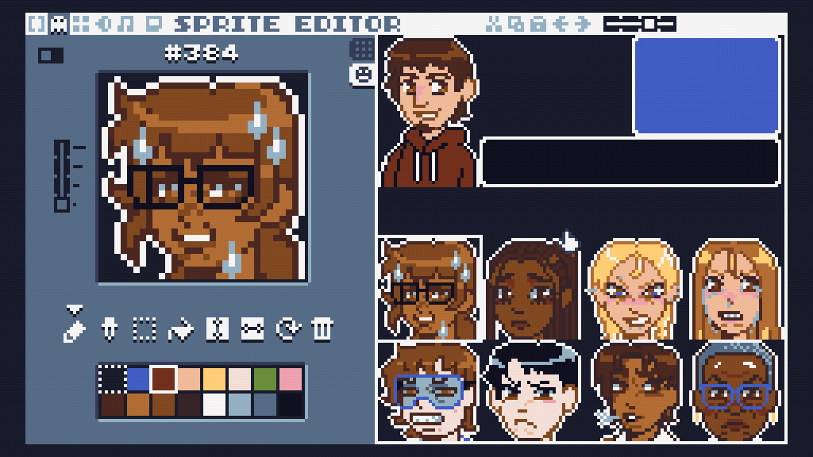

# Make Project - Campus Cupid

## Introduction
“Campus Cupid” is a TIC80 dating sim that follows a Swattie as they study for their finals during reading week. Inspired by popular dating sims like Date Everything, instead of dating people, the player “dates” anthropomorphized versions of Swarthmore academic buildings. The goal of the game is to build strong relationships with each of the buildings, as the better you get along with them, the better you study - which is reflected in your final grade. The gameplay is completely dialogue and choice-based, where it is up to the player to decide how they want to respond and communicate with the buildings. The choices that the player makes have consequences, as the kinder you are to a building, the friendlier they become. Inversely, buildings that the player is rude to will avoid conversation and send the player away, negatively impacting their final exam scores. Choose wisely with how you respond!

## Creative Aspects
Since “Campus Cupid” is an original idea of ours, we really wanted to make it something unique and comical. However, coming up with a completely unique idea requires a lot of creative direction and planning. We first began with brainstorming what buildings we wanted to include in the game. We focused on which campus buildings would fit best on a vertical map layout, and which buildings would make the most interesting characters. When creating the characters, we wanted their personalities to reflect the type of Swattie you would find in each building (which are obviously hyperbolized for comedic effect). The game serves as a satirical representation of different students on campus and is not meant to be taken seriously. 

We strived to make “Campus Cupid” not just a coding feat, but impressive from an artistic standpoint as well. The game includes 9 unique 32 x 48 pixel character sprites, as well as one additional expression for 8 of the 9 characters.





In terms of writing, each character has three days worth of dialogue, each containing different variations depending on the relationship status between the player and the building. Characters are responsive to the different choices the player chooses in conversation, creating a game with infinite possibilities and replayability. We ended up writing 24 pages worth of dialogue for the game, a testament to our artistic commitment to the project.

## Implementation
Before actually writing any code, we wanted to choose some design patterns that made sense with our concept. We decided to focus our efforts on implementing a state management system and taking advantage of lazy initialization. 

We are aware that the game loop is already present within the code because TIC80 runs the TIC function every frame. Therefore, this is not a design pattern that we necessarily implemented. 

We figured that using a state manager would help keep our code organized and make it easy to swap between different modes of the game such as: map traversal, conversation, title screen, ending screen, and the calendar screen. Our implementation of this pattern can mainly be seen in our TIC() function, which makes several calls to other functions that handle updating each of the states. 

```lua
function TIC()

    cls()

    if state == "game" then --game state, movement in map
        update_game_state()
    elseif state == "popup" then --popup state, player is being prompted
        update_popup_state()
    elseif state == "talking" then --talking state, player is in conversation
        update_talking_state()
    elseif state == "calendar" then 
        update_calendar_state()
    elseif state == "title" then
        update_title_state()
    elseif state == "end" then
        update_end_state()
    elseif state == "disclaimer" then
        update_disclaimer_state()
    end

end
```

Our choice to use lazy initialization was made after seeing the sheer amount of dialogue our game would require. Because not every line of dialogue is used within a single run of the game, it makes more sense to only initialize a script when we know it is going to be used. Every building’s dialogue gets initialized within its own init function, which is called the first time a player walks up and decides to converse with a building. Using lazy initialization helps save a lot of room and prevents unnecessary allocation of space that we would never actually need to access during certain runs of the game.

```lua
-- for lazy initialization design pattern
function initialize_building(name, id)
    local tab = buildings[id].script
    if buildings[id].init == 0 then 
        if name == "McCabe" then
            init_mccabe()
            tab[0] = mccabe_day_1
            tab[1] = mccabe_day_2
            tab[2] = mccabe_day_3
        elseif name == "Parrish" then
            init_parrish()
            tab[0] = parrish_day_1
            tab[1] = parrish_day_2
            tab[2] = parrish_day_3
        elseif name == "Kohlberg" then
            init_kohl()
            tab[0] = kohl_day_1
            tab[1] = kohl_day_2
            tab[2] = kohl_day_3
        elseif name == "LPAC" then
            init_lpac()
            tab[0] = lpac_day_1
            tab[1] = lpac_day_2
            tab[2] = lpac_day_3
        elseif name == "Lang Music" then
            init_langmu()
            tab[0] = langmu_day_1
            tab[1] = langmu_day_2
            tab[2] = langmu_day_3
        elseif name == "Martin" then
            init_martin()
            tab[0] = martin_day_1
            tab[1] = martin_day_2
            tab[2] = martin_day_3
        elseif name == "Sci" then
            init_sci()
            tab[0] = sci_day_1
            tab[1] = sci_day_2
            tab[2] = sci_day_3
        elseif name == "Singer" then
            init_singer()
            tab[0] = singer_day_1
            tab[1] = singer_day_2
            tab[2] = singer_day_3
        end
        buildings[id].init = 1
    end
end
```

Additionally, there are aspects of our code that we are proud of other than our design patterns. For example, we decided to use lua’s only data structure, the table, to implement our diverging conversation scripts. However, we decided to treat our tables as tree graphs where each node is the text being said and each edge is the connection between one line of dialogue and the one that follows. Specifically, each full interaction is one table. Inside of this table, there are subtables holding each line of the conversation. These subtables hold the current line being said, the possible player responses to this line, and the path to the building’s next response based on what the player selects. When drawn out, this resembles a tree graph, which is what leads us to call it a tree even though it is just a table of other tables. 

## Challenges/limitations
One of the biggest challenges we faced while working on this project was the limited tools available when creating sprites. Making a diverse cast with only 16 colors was difficult. Furthermore, the limited amount of space available to hold sprites limited the amount of characters we could have and the amount of expressions we could make for our character. If we were to make this game under different circumstances (i.e. with a different game engine) our sprites would be more detailed and we would have more facial expressions for our characters. Ideally our characters would also be animated, but we did not have enough space for this. 

Another limitation we faced was having to cut down on the amount of dialogue in our game. Originally, we wanted to have five days worth of dialogue for each of our characters. However, this would have taken up almost 1000 more lines of code and we didn’t want our file to be completely unmanageable to work with. In an ideal situation, we would have our character dialogue in different files from our code so that it wouldn’t clutter up our main file. Since TIC80 makes it difficult to read in from other files, we couldn’t design our game as originally intended. 

## Conclusion

“Campus Cupid” is our favorite project from this class, and we are very proud of the end result. Creating a text-based game provided new challenges that we did not face while making ‘Pigs in Space” or “Splatoon”. We were very excited to take extreme creative liberties with our game, and are very satisfied with seeing the fruits of our labor come together and create a final product. Creating a game about interacting with buildings during finals week while we ourselves were in finals week and sitting in said buildings was a very meta experience, and not one that we expect to ever face again during our time at Swarthmore. 
